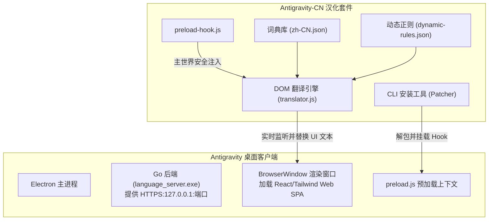

# Antigravity-CN 🚀

<div align="center">

**Google Antigravity 官方级全界面深度汉化补丁与中文增强套件**  
*Community-Driven Deep Chinese Localization & Enhancement Suite for Google Antigravity*

[](./LICENSE)
[](./CONTRIBUTING.md)
[](https://nodejs.org/)
[](#)

[快速开始](#-快速安装) • [核心特性](#-核心特性) • [架构原理](#-技术架构与原理) • [Agent中文规则](#-agent-中文交互规则增强) • [贡献指南](#-参与贡献) • [English](./README_EN.md)

</div>

---

## 📖 项目简介

[Google Antigravity](https://antigravity.google) 是一款功能强大的下一代 AI-First 桌面开发平台与全自主智能体系统。然而，其官方界面与交互目前仅支持纯英文，许多中国开发者在使用时面临：

1. **界面全英文**：侧边栏、设置面板、终端沙箱权限审批、产物面板及任务调度器等缺乏中文翻译；
2. **交互语言偏移**：Agent 在多轮对话、编写 Git Commit 或生成代码注释时容易频繁跳出英文。

**Antigravity-CN** 是一个开源的非侵入式中文化套件，采用 **Electron 动态渲染劫持 + DOM 纳秒级词典映射** 技术，无需破坏或反编译官方后端二进制文件，即可为 Antigravity 带来稳定、地道、丝滑的全界面中文体验！

---

## ✨ 核心特性

- 🎯 **全界面深度汉化**：全面覆盖侧边栏、主工作区、聊天画布、设置面板（通用、外观、模型选择、权限策略、终端沙箱）、辅助面板（子智能体、后台任务、交付产物、文件改动）及原生菜单。
- 🛡️ **代码与终端严格隔离保护**：智能忽略 `<pre>`、`<code>`、Monaco 编辑器、Prism 代码高亮、Xterm 终端输出及富文本编辑器内容，**100% 确保开发者代码与模型输出内容不被误篡改**。
- ⚡ **无损非侵入式注入**：仅在 Electron 的 `preload.js` 阶段挂载轻量级 MutationObserver 引擎，无需改动庞大的后端二进制服务，版本升级兼容性极佳。
- 🔄 **自带备份与一键秒级还原**：首次安装自动生成原始文件备份（`.original_backup`），随时可通过一条命令完整还原至官方英文原版，安全无忧。
- 🤖 **Agent 中文交互规范增强包**：提供配套的 `GEMINI.md` 全局规则，规范 Agent 使用中文深度思考、撰写符合规范的中文 Git 提交信息与函数注释。
- 🔍 **独家「词条检查器」模式**：按下 <kbd>Ctrl</kbd> + <kbd>Shift</kbd> + <kbd>L</kbd> 即可开启检查模式，按住 <kbd>Alt</kbd> 点击任何未翻译英文，自动将 JSON 词条模板复制到剪贴板，社区贡献零门槛！

---

## 🚀 快速安装

> **前置要求**：电脑上已安装 Node.js (推荐 v18 或更高版本)。

### 方式一：NPX 一键安装（推荐，无需手动克隆）

在终端（Windows PowerShell / CMD / macOS Terminal）中运行：

```bash
# 1. 彻底退出 Antigravity 应用后，执行安装命令：
npx antigravity-chinese install
```

如需还原官方英文原版：
```bash
npx antigravity-chinese restore
```

---

### 方式二：克隆仓库安装（适合开发者与社区贡献者）

```bash
# 1. 克隆本仓库
git clone https://github.com/paopao-amns/antigravity-cn.git
cd antigravity-cn

# 2. 安装必要依赖
npm install

# 3. 执行安装补丁
npm run install-patch
```

- **Windows 用户**：可以直接双击运行目录下的 [`install.bat`](./install.bat) 或使用 PowerShell 运行 [`install.ps1`](./install.ps1)。
- **macOS / Linux 用户**：直接运行 `bash install.sh`。

---

## 🛠️ CLI 命令与参数选项

```bash
npx antigravity-chinese <command> [options]
```

### 命令列表
| 命令 | 别名 | 功能说明 |
| :--- | :--- | :--- |
| `install` | `i` | 自动检测 Antigravity 路径并安装汉化补丁（自动创建备份） |
| `restore` | `r`, `uninstall` | 还原为官方原始英文版 |
| `status` | `s` | 查看当前系统的 Antigravity 安装与补丁应用状态 |
| `help` | `-h` | 显示帮助手册 |

### 常用参数
- `--path <dir>`：手动指定 Antigravity 安装路径或 resources 目录（适用于便携版或非默认路径安装）。
  ```bash
  npx antigravity-chinese install --path "D:\Software\Antigravity"
  ```
- `--force`, `-f`：忽略应用正在运行的警告检测，强制执行补丁安装。

---

## 🧠 Agent 中文交互规则增强

除了界面汉化外，强烈建议为 Agent 开启全局中文规则支持。本套件提供了精心调试的 [`rules/GEMINI.md`](./rules/GEMINI.md)。

一键应用至全局配置：
```bash
node rules/apply-rules.js
```
此命令会将规范写入 `~/.gemini/config/GEMINI.md`，使所有会话和项目中的 Agent 均具备以下能力：
1. **纯中文思维链**：Agent 的 Thinking Process 和用户交互全面采用清晰的中文表述；
2. **中文 Git 提交信息**：遵循 Conventional Commits 格式，用中文清晰描述变更意图；
3. **中文代码文档与注释**：为新建的函数或复杂逻辑生成规范的中文说明。

---

## 🏗️ 技术架构与原理



1. **检测与挂载**：安装程序自动定位 `resources/app.asar`，备份后将轻量级 Hook 注入至 `dist/preload.js`；
2. **主世界沙箱执行**：页面加载时通过 `webFrame.executeJavaScript` 在主页面渲染环境中载入高性能翻译引擎；
3. **微任务批处理观察者**：采用 `MutationObserver` + `requestAnimationFrame` 异步分批处理 DOM 节点变动，零掉帧、零卡顿；
4. **安全过滤白名单/黑名单**：严格识别代码容器，自动跳过用户代码与实时终端输出。

---

## 🤝 参与贡献

我们非常期待你的加入！无论你是一名前端开发者、翻译爱好者还是日常重度用户：

1. **补充未翻译词条**：按下 <kbd>Ctrl</kbd> + <kbd>Shift</kbd> + <kbd>L</kbd> 开启词条检查器，点击复制文本后提 PR 补充到 [`locales/zh-CN.json`](./locales/zh-CN.json)；
2. **改进润色翻译**：如果发现任何不符合中国开发者习惯的生硬翻译，随时提交修改建议；
3. **提交 Issue**：遇到任何兼容性或安装报错，欢迎提交 [Bug Report](https://github.com/paopao-amns/antigravity-cn/issues)。

详情请参阅我们的 [贡献指南 (CONTRIBUTING.md)](./CONTRIBUTING.md)。

---

## ❓ 常见问题 (FAQ)

<details>
<summary><strong>Q: 官方发布新版本更新后，汉化补丁会失效吗？</strong></summary>
官方推送并覆盖更新后，<code>app.asar</code> 会被重置回官方原版。此时只需重新运行一次 <code>npx antigravity-chinese install</code> 即可满血恢复汉化，原有的词典会自动适配新版本大部分界面！
</details>

<details>
<summary><strong>Q: 会影响 Agent 生成的代码或终端输出吗？</strong></summary>
<strong>绝对不会。</strong> 汉化引擎对代码容器（如 <code>&lt;pre&gt;</code>、<code>&lt;code&gt;</code>、Monaco 编辑器、Xterm 终端流）做了底层隔离保护，只翻译 Antigravity 软件本身的 UI 按钮、菜单、提示文本和对话操作控件。
</details>

<details>
<summary><strong>Q: 是否会导致软件卡顿或增加内存占用？</strong></summary>
补丁核心文件体积不到 50KB，内存占用基本可以忽略不计。翻译引擎使用 <code>WeakSet</code> 避免重复计算，所有 DOM 变动均通过微任务队列批处理，实测对软件流畅度毫无影响。
</details>

---

## 📄 开源许可证

本项目基于 [MIT 许可证](./LICENSE) 开源。
